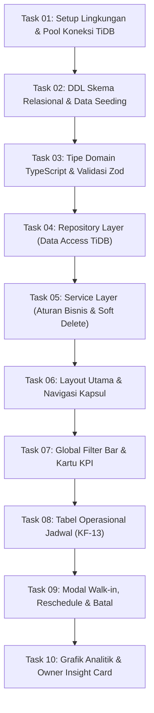

# AGENT OPERATING PROTOCOL & EXECUTION FLOW (AGENTS.MD)

## Panduan Eksekusi AI & Standar Pengembangan Sistem MMZ Booking Management
**Entitas Bisnis:** MMZ Studio Foto  
**Tipe Produk:** Web Application Dashboard (Admin & Owner)  
**Status Dokumen:** Mandatori untuk seluruh agen AI sebelum mengeksekusi kode atau perintah terminal.

---

## 1. Protokol Pra-Eksekusi (Pre-Flight Checks) — WAJIB

Setiap kali agen AI menerima tugas atau akan melakukan modifikasi kode, agen **DILARANG LANGSUNG MENULIS KODE** tanpa menjalankan tahapan verifikasi dokumen dan kepatuhan skill berikut:

### 1.1 Verifikasi Dokumen Acuan (`docs/`)
Agen wajib memeriksa dan menyelaraskan perubahan terhadap 3 dokumen acuan utama:
1. **[docs/prd.md](prd.md) (Product Requirement Document):**
   - Pastikan fitur memenuhi kode spesifikasi fungsional (**KF-01 s.d. KF-13**) dan non-fungsional (**KNF-01 s.d. KNF-05**).
   - Pastikan aturan bisnis ditaati, khususnya **Aturan Soft Delete (Bab 4.5 PRD)**: Dilarang keras melakukan `DELETE FROM test.bookings`. Pembatalan dilakukan dengan mengubah `status_booking = 'batal'`.
2. **[docs/ARCHITECTURE.md](ARCHITECTURE.md) (Sistem Arsitektur):**
   - Ikuti pembagian lapisan (*Layered Clean Architecture*): `Presentation` $\rightarrow$ `Validation (Zod)` $\rightarrow$ `Service (Business Rules)` $\rightarrow$ `Repository (SQL Queries)` $\rightarrow$ `TiDB Connection Pool`.
   - Pastikan alur transaksi mengikuti diagram sekuensial (deteksi bentrok jadwal ganda / *double booking prevention* pada TiDB dan Google Calendar).
3. **[docs/DESIGN_SYSTEM.md](DESIGN_SYSTEM.md) (Desain Sistem Antarmuka):**
   - Ikuti estetika Zentra Dashboard: Latar belakang kanvas abu-abu terang (`#F4F5F7`), kartu putih bersih dengan kelengkungan besar (`rounded-3xl` / 24px), elevasi difus lembut (`shadow-card`), dan elemen navigasi berbentuk kapsul (*pill*).
   - Patuhi kode warna semantik studio: **Studio 1 = Biru Elektrik (`#2563EB`)**, **Studio 2 = Hijau Emerald (`#059669`)**.

### 1.2 Penegakan Skill `.agents/skills`
Agen wajib menerapkan prinsip teknis dari dua skill terpasang:
1. **`backend-craft` (`.agents/skills/backend-craft/SKILL.md`):**
   - **Intent-First Analysis**: Klasifikasikan mode sebagai *Production-SaaS/BFF*; jangan menulis kode boilerplate tanpa alasan senior engineer.
   - **Library-First Principle**: Gunakan library matang manusia (`mysql2/promise`, `zod`, `clsx`, `tailwind-merge`, `lucide-react`, `date-fns`). Hindari membuat validasi atau utilitas buatan sendiri dari nol (*no hand-rolled validation*).
   - **Production-Grade Non-Negotiables**: Strict TypeScript (tidak boleh ada kebocoran `any`), parameter binding pada seluruh query SQL (cegah SQL Injection), koneksi pool TiDB resilien dengan TLS/SSL dan penanganan timeout/retry, centralized error handling.
   - **Anti-AI-Tell**: Jangan gunakan `console.log` liar untuk penanganan error bisnis; gunakan error boundaries dan response envelope yang rapi.
2. **`ui-taste` (`.agents/skills/ui-taste/SKILL.md`):**
   - **Anti-UI-Slop**: Hindari border hitam pekat kaku, bayangan tajam, warna abu-abu mati, dan teks yang bertumpuk.
   - **Tipografi Hierarkis**: Angka metrik KPI ditampilkan sangat dominan (`text-4xl font-semibold tracking-tight`), dipadu label ringkas dan badge tren persentase.
   - **Mikro-Interaksi**: State hover baris tabel yang lembut, feedback visual pada tombol klik, badge status warna semantik yang kontras dan mudah dibaca kasir.

---

## 2. Pedoman Bahasa & Komunikasi (Language & UX Writing Rules)

### 2.1 Git Commit Messages: WAJIB BAHASA INGGRIS (Conventional Commits)
Setiap kali menyelesaikan task atau sub-task, agen wajib memberikan rekomendasi commit message dalam **Bahasa Inggris** dengan format:
```text
<type>(<scope>): <short imperative summary>

[optional body explaining why and what]
```
Contoh:
- `feat(db): configure resilient TiDB Cloud connection pool with TLS/SSL`
- `feat(table): implement operational schedule table with WhatsApp direct links`
- `fix(booking): prevent double-booking slot collision on walk-in submissions`

### 2.2 UX Writing Antarmuka: WAJIB 100% BAHASA INDONESIA
Seluruh teks yang tampil pada antarmuka pengguna (label form, placeholder, judul tabel, nama kolom, status badges, tombol aksi, empty states, error toast, dialog konfirmasi) **WAJIB MENGGUNAKAN BAHASA INDONESIA** yang profesional, santun, ringkas, dan jelas untuk staf studio MMZ.

#### Kamus Istilah UX Writing MMZ Studio:
| Istilah Teknis / EN | Teks Antarmuka (Bahasa Indonesia Baku) | Contoh Pemakaian |
| :--- | :--- | :--- |
| Overview / Home | **Ringkasan Operasional** / **Overview** | Label tab navigasi utama |
| Schedule Table | **Jadwal Sesi Operasional** | Judul tabel utama (KF-13) |
| Walk-in Booking | **Booking Walk-in** / **Pemesanan Manual** | Tombol header `+ Booking Walk-in` |
| Settle Payment | **Tandai Lunas** / **Pelunasan Kasir** | Tombol aksi cepat di baris tabel |
| Cancel Booking | **Batalkan Reservasi** | Tombol aksi pembatalan |
| Reschedule | **Atur Ulang Jadwal** / **Reschedule** | Tombol aksi pemindahan jam |
| Total Booking | **Total Reservasi** | Kartu Scorecard KPI 1 |
| Total Down Payment | **Total Akumulasi DP** | Kartu Scorecard KPI 2 |
| Confirmed Bookings | **Pemesanan Terkonfirmasi** | Kartu Scorecard KPI 3 |
| Pending Settlement | **Menunggu Pelunasan** | Kartu Scorecard KPI 4 |
| Filter Studio: All | **Semua Ruangan** | Pilihan dropdown studio |
| Refresh Data | **Perbarui Data** | Tombol refresh tabel tanpa reload |
| Payment Status: Paid | **Lunas** (Badge Hijau) | Status pembayaran 100% |
| Payment Status: DP Paid | **DP Diterima** (Badge Amber) | Sisa pelunasan di kasir |
| Payment Status: Unpaid | **Menunggu Pembayaran** | Belum ada uang muka |
| Booking Status: Canceled | **Dibatalkan** (Badge Merah) | Riwayat pemesanan batal |

#### Standar Pesan Dialog & Notifikasi (Toast Messages):
* **Konfirmasi Pembatalan (*Soft Delete*):**
  > *"Apakah Anda yakin ingin membatalkan jadwal pemotretan ini? Status pesanan akan diubah menjadi 'Dibatalkan' dan slot kalender akan dibebaskan, namun catatan uang muka (DP) tetap tersimpan untuk pembukuan."*
* **Error Bentrok Jadwal (*Double Booking Prevention*):**
  > *"Slot jadwal pada tanggal dan jam tersebut sudah terisi untuk Studio yang dipilih. Silakan pilih ruangan lain atau sesuaikan jam sesi foto."*
* **Sukses Reservasi Walk-in:**
  > *"Pemesanan walk-in berhasil disimpan dan event kalender telah diperbarui."*
* **Sukses Pelunasan:**
  > *"Status pembayaran berhasil diperbarui menjadi Lunas."*

---

## 3. Alur Kerja Eksekusi Bertahap (10-Step Execution Flow)

Setiap tahapan harus diselesaikan secara berurutan, diverifikasi, dan diberi rekomendasi commit message:



---

### Task 01: Setup Lingkungan & Pool Koneksi TiDB Cloud
* **Tujuan:** Menyiapkan konfigurasi `.env`, `.env.example`, dan koneksi pool MySQL resilien dengan TLS/SSL aktif (`ssl: { rejectUnauthorized: true }`) serta retry backoff.
* **Acuan Dokumen:** `docs/ARCHITECTURE.md` Bab 3.4 & 8.1; `backend-craft` (Reliability, Config validation).
* **Lokasi File:** `.env.example`, `src/lib/db.ts`
* **Rekomendasi Commit Message (EN):**
  ```text
  feat(db): setup resilient TiDB Cloud connection pool with TLS/SSL
  ```

---

### Task 02: DDL Skema Relasional & Data Seeding
* **Tujuan:** Membuat skrip SQL (`src/lib/schema.sql`) untuk pembuatan tabel `customers`, `paket_layanan`, `lokasi`, `admin`, `bookings`, `sesi_percakapan` beserta indeks komposit performa query $\le 2$s dan data seed master ruangan (Studio 1 & Studio 2) dan katalog paket.
* **Acuan Dokumen:** `docs/prd.md` Bab 3 & Bab 5; `docs/ARCHITECTURE.md` Bab 3.
* **Lokasi File:** `src/lib/schema.sql` (atau skrip migrasi inisial)
* **Rekomendasi Commit Message (EN):**
  ```text
  feat(db): define relational schema and seed studio master data
  ```

---

### Task 03: Tipe Domain TypeScript & Skema Validasi Zod
* **Tujuan:** Mendefinisikan tipe entitas domain TypeScript yang presisi serta skema validasi Zod untuk payload input walk-in, reschedule, dan parameter filter.
* **Acuan Dokumen:** `docs/prd.md` Bab 4; `backend-craft` (Zod everywhere, Strict TypeScript).
* **Lokasi File:** `src/types/booking.ts`, `src/types/database.ts`, `src/validations/booking.schema.ts`
* **Standar UX Writing:**
  - *"Nama lengkap pelanggan wajib diisi minimal 3 karakter."*
  - *"Nomor WhatsApp harus berformat valid (contoh: 08123456789 atau 628123456789)."*
  - *"Nominal uang muka (DP) tidak boleh bernilai negatif."*
* **Rekomendasi Commit Message (EN):**
  ```text
  feat(validation): implement domain types and Zod schemas for booking operations
  ```

---

### Task 04: Repository Layer (Data Access TiDB Cloud)
* **Tujuan:** Mengimplementasikan modul kueri SQL berparameter (*Prepared Statements*) untuk pembacaan tabel operasional, kueri agregasi KPI, filter multi-kriteria, dan kueri analitik grafik.
* **Acuan Dokumen:** `docs/prd.md` Bab 5.1 s.d. 5.3; `docs/ARCHITECTURE.md` Bab 2.
* **Lokasi File:** `src/repositories/booking.repository.ts`, `src/repositories/analytics.repository.ts`
* **Rekomendasi Commit Message (EN):**
  ```text
  feat(repository): add SQL repository queries for bookings and analytics
  ```

---

### Task 05: Service Layer (Aturan Bisnis & Soft Delete)
* **Tujuan:** Mengimplementasikan `BookingService` untuk pencegahan bentrok jadwal (*conflict detection*), kalkulasi `jam_selesai` otomatis berdasarkan paket, pelunasan kasir, dan penegakan *Soft Delete* (`UPDATE status_booking = 'batal'`).
* **Acuan Dokumen:** `docs/prd.md` Bab 4.4 & 4.5; `docs/ARCHITECTURE.md` Bab 4.
* **Lokasi File:** `src/services/booking.service.ts`
* **Rekomendasi Commit Message (EN):**
  ```text
  feat(service): implement booking business logic with double-booking prevention and soft-delete
  ```

---

### Task 06: Layout Utama & Navigasi Kapsul (Zentra Style)
* **Tujuan:** Membangun root layout dan topbar navigasi horizontal bergaya modern SaaS Zentra: Tab aktif berupa kapsul hitam kontras (`#18181B`), tombol pencarian, notifikasi, dan avatar profil staf.
* **Acuan Dokumen:** `docs/DESIGN_SYSTEM.md` Bab 5.1; `ui-taste` (Anti-UI slop, clean topbar).
* **Lokasi File:** `src/app/layout.tsx`, `src/components/layout/topbar.tsx`
* **Standar UX Writing:**
  - Tab Menu: *"Ringkasan"*, *"Jadwal Sesi"*, *"Pelanggan"*, *"Paket Layanan"*, *"Laporan"*
* **Rekomendasi Commit Message (EN):**
  ```text
  feat(ui): create responsive topbar with active pill navigation
  ```

---

### Task 07: Global Filter Bar & Kartu KPI (Scorecards)
* **Tujuan:** Mengimplementasikan kontrol filter berbentuk kapsul (rentang tanggal, filter Studio 1/Studio 2, filter status pembayaran, tombol perbarui data) serta 4 kartu metrik KPI dengan tipografi angka besar (`text-4xl`), badge tren, dan *striped progress bar*.
* **Acuan Dokumen:** `docs/prd.md` Bab 4.1 & 4.2; `docs/DESIGN_SYSTEM.md` Bab 5.2 & 5.3.
* **Lokasi File:** `src/components/dashboard/global-filter-bar.tsx`, `src/components/dashboard/kpi-scorecards.tsx`
* **Standar UX Writing:**
  - *"Semua Ruangan"*, *"Studio 1"*, *"Studio 2"*
  - *"Semua Status"*, *"Lunas"*, *"DP Diterima"*, *"Menunggu Pembayaran"*
  - *"Total Reservasi"*, *"Total Akumulasi DP"*, *"Pemesanan Terkonfirmasi"*, *"Menunggu Pelunasan"*
  - *"Perbarui Data"*
* **Rekomendasi Commit Message (EN):**
  ```text
  feat(ui): implement global filter bar and KPI scorecards with micro-visuals
  ```

---

### Task 08: Tabel Operasional Jadwal Booking (KF-13)
* **Tujuan:** Membangun tabel terstruktur dalam kartu putih `rounded-3xl` dengan kolom: Waktu Sesi, Badge Studio (Biru/Hijau), Nama Customer, Link Direct WhatsApp (`wa.me/`), Paket & Background, Nominal DP, Badge Status Pembayaran & Booking, serta tombol aksi cepat (Lunas, Reschedule, Batalkan).
* **Acuan Dokumen:** `docs/prd.md` Bab 4.3; `docs/DESIGN_SYSTEM.md` Bab 5.5.
* **Lokasi File:** `src/components/dashboard/operational-table.tsx`, `src/components/ui/status-badge.tsx`
* **Standar UX Writing:**
  - Kolom: *"WAKTU SESI"*, *"STUDIO"*, *"PELANGGAN"*, *"PAKET & CATATAN"*, *"UANG MUKA (DP)"*, *"PEMBAYARAN"*, *"STATUS"*, *"AKSI"*
  - Tombol aksi: *"Lunas"*, *"Reschedule"*, *"Batalkan"*
  - Empty state: *"Belum ada jadwal pemotretan pada rentang tanggal ini."*
* **Rekomendasi Commit Message (EN):**
  ```text
  feat(ui): build operational schedule table with WhatsApp direct links and action buttons
  ```

---

### Task 09: Modal Form Interaktif (Walk-in, Reschedule & Soft Delete)
* **Tujuan:** Membangun modal dialog untuk input reservasi walk-in (lengkap dengan validasi bentrok jadwal), modal reschedule, dan modal dialog konfirmasi pembatalan pesanan (*soft delete*).
* **Acuan Dokumen:** `docs/prd.md` Bab 4.4 & 4.5; `docs/DESIGN_SYSTEM.md` Bab 5.
* **Lokasi File:** `src/components/dashboard/walkin-modal.tsx`, `src/components/dashboard/reschedule-modal.tsx`, `src/components/dashboard/cancel-dialog.tsx`
* **Standar UX Writing:**
  - Judul: *"Input Booking Walk-in Baru"*, *"Atur Ulang Jadwal (Reschedule)"*, *"Konfirmasi Pembatalan Booking"*
  - Tombol: *"Simpan Pemesanan"*, *"Konfirmasi Reschedule"*, *"Ya, Batalkan Jadwal"*, *"Batal / Kembali"*
* **Rekomendasi Commit Message (EN):**
  ```text
  feat(ui): implement walk-in booking modal, reschedule modal, and cancel confirmation dialog
  ```

---

### Task 10: Visualisasi Grafik Analitik & Owner Insight Card
* **Tujuan:** Menampilkan visualisasi grafik batang untuk Paket Terlaris, diagram donat untuk Rasio Utilisasi Studio 1 vs Studio 2, dan kartu analitik bergradien (*sunset to ocean mesh*) dengan aksen *frosted glass* untuk insight evaluasi Owner.
* **Acuan Dokumen:** `docs/prd.md` Bab 5.3; `docs/DESIGN_SYSTEM.md` Bab 5.4.
* **Lokasi File:** `src/components/charts/top-packages-chart.tsx`, `src/components/charts/studio-ratio-chart.tsx`, `src/components/dashboard/owner-insight-card.tsx`
* **Standar UX Writing:**
  - Judul: *"Paket Terlaris"*, *"Rasio Utilisasi Studio"*, *"Insight Performa Owner"*
  - Keterangan: *"Perbandingan jumlah sesi Studio 1 vs Studio 2"*
* **Rekomendasi Commit Message (EN):**
  ```text
  feat(ui): render top packages chart, studio utilization ratio, and owner insight card
  ```

---

## 4. Checklist Kualitas Akhir (Quality Gate Checklist)

Sebelum menandai keseluruhan sistem selesai, agen wajib memverifikasi:
- [ ] Seluruh dokumen pada folder `docs/` (`prd.md`, `ARCHITECTURE.md`, `DESIGN_SYSTEM.md`) telah dipatuhi 100%.
- [ ] Aturan *Soft Delete* terbukti berjalan: tidak ada pemanggilan `DELETE FROM test.bookings`.
- [ ] Validasi *Double Booking* berhasil menolak pemesanan di slot studio yang sama pada jam yang bertabrakan.
- [ ] Semua teks antarmuka (UX Writing) 100% menggunakan Bahasa Indonesia yang konsisten dan rapi.
- [ ] Seluruh rekomendasi Git Commit Message ditulis dalam Bahasa Inggris sesuai format Conventional Commits.
- [ ] Tidak ada error linting TypeScript (`npm run lint` lolos bersih).
