# TASK BREAKDOWN & IMPLEMENTATION PROMPTING GUIDE
## Operational Monitoring & Transaction Management Information System — MMZ Photo Studio

**Reference Documents:**
- `docs/prd.md` (Functional Requirements KF-01 to KF-13 & Non-Functional Requirements KNF-01 to KNF-05)
- `docs/ARCHITECTURE.md` (System Architecture, C4 Container Model, TiDB Cloud, Google Calendar API v3, n8n, Layered Clean Architecture)
- `docs/DESIGN_SYSTEM.md` (Zentra Modern SaaS Aesthetic, Anti-UI-Slop, Tailwind v4 Tokens, Studio Color Palette)
- `docs/AGENTS.md` (Agent Operational Protocol, Library-First Principle, Indonesian UI Copy, English Git Commits)

---

## Execution Roadmap Summary

```mermaid
flowchart TD
    subgraph Phase_0 ["Phase 0: Dependency Initialization"]
        T0["Task 00: Library Installation & Project Baseline Setup"]
    end

    subgraph Phase_1 ["Phase 1: Data Infrastructure & Connectivity"]
        T1["Task 01: Environment Configuration & Resilient TiDB Connection Pool"]
        T2["Task 02: Relational DDL Schema, Composite Indices & Master Seeding"]
    end

    subgraph Phase_2 ["Phase 2: Domain, Validation & Data Access"]
        T3["Task 03: TypeScript Domain Types & Zod Validation Schemas"]
        T4["Task 04: Repository Layer (TiDB Cloud Data Access)"]
    end

    subgraph Phase_3 ["Phase 3: Business Logic & External Integrations"]
        T5["Task 05: BookingService (Double Booking Prevention & Soft Delete)"]
        T6["Task 06: Google Calendar Sync & n8n Outbound Webhook Dispatcher"]
    end

    subgraph Phase_4 ["Phase 4: Shell Architecture & Navigation"]
        T7["Task 07: Global Design Tokens, Root Layout & Topbar Pill Navigation"]
    end

    subgraph Phase_5 ["Phase 5: Operational Dashboard & Metrics"]
        T8["Task 08: Global Filter Bar & KPI Scorecards with Micro-visuals"]
        T9["Task 09: Operational Schedule Table (KF-13, Direct WA Links & Settle Action)"]
    end

    subgraph Phase_6 ["Phase 6: Transaction Modals & Interactive Dialogs"]
        T10["Task 10: Walk-in Booking Modal Form (Real-time Conflict Checking)"]
        T11["Task 11: Reschedule Modal & Soft-Delete Cancellation Confirmation Dialog"]
    end

    subgraph Phase_7 ["Phase 7: Analytics & Owner Insights"]
        T12["Task 12: Top-Selling Packages Chart & Studio Utilization Ratio Donut"]
        T13["Task 13: Hero Owner Gradient Insight Card & Unified Dashboard Page Assembly"]
    end

    subgraph Phase_8 ["Phase 8: Quality Gate & Hardening"]
        T14["Task 14: Final Quality Audit, TypeScript Linting & Production Build Check"]
    end

    T0 --> T1 --> T2 --> T3 --> T4 --> T5 --> T6 --> T7 --> T8 --> T9 --> T10 --> T11 --> T12 --> T13 --> T14
```



---

## How to Use This Document

Each task detailed below includes:
1. **Identity & System References:** Direct mapping to Functional (KF) / Non-Functional (KNF) requirements and reference documents.
2. **Description & Goals:** Clear objective and scope of work.
3. **Target Files:** Absolute or relative file paths created or modified.
4. **Acceptance Criteria:** Verifiable technical and functional checklist.
5. **Git Commit Recommendation:** Standard Conventional Commits message in English.
6. **Ready-to-Use Prompt:** A comprehensive, battle-tested prompt designed to be directly copied and pasted into an AI coding assistant.
   *(Note: While prompts and instructions are in English, the application's user interface text such as buttons, labels, badges, toasts, and dialogs MUST remain 100% in Indonesian as mandated by MMZ Studio operational standards).*

---

# PHASE 0: DEPENDENCY INITIALIZATION

## Task 00: Library Installation & Project Baseline Setup

- **Category:** Dependency Management & Tooling
- **References:** `docs/ARCHITECTURE.md` Section 6, `docs/AGENTS.md` Section 1.2 (`backend-craft`, Library-First Principle)
- **Target Files:** `package.json`, `tsconfig.json`, `src/lib/utils.ts`
- **Objective:** Install mature, industry-standard human-written dependencies (Zod, mysql2, Lucide icons, clsx, tailwind-merge, date-fns) to eliminate risky hand-rolled utilities.

### Acceptance Criteria
- [ ] Runtime packages installed: `mysql2`, `zod`, `lucide-react`, `clsx`, `tailwind-merge`, `date-fns`.
- [ ] Dev/type packages installed: `@types/mysql2` or strict TypeScript type configuration.
- [ ] Zero peer-dependency conflicts with React 19 and Next.js 16.
- [ ] Utility helper `src/lib/utils.ts` created, exporting standard `cn(...inputs)` combining `clsx` and `twMerge`.

### Recommended Git Commit
```text
chore(deps): install runtime dependencies for database, validation, and UI icons
```

### PROMPT FOR TASK 00
```markdown
As a Senior Fullstack Engineer adhering to the `backend-craft` skill (Library-First Principle) on Next.js 16 App Router with React 19:

Please inspect and install the mature human-written libraries required for the MMZ Booking Management project based on `docs/ARCHITECTURE.md` and `docs/AGENTS.md`.

Install the following packages:
1. Database: `mysql2` (driver with Promise API support and TLS/SSL capability).
2. Domain & Validation: `zod` (end-to-end schema validation).
3. Iconography: `lucide-react` (matching `docs/DESIGN_SYSTEM.md` specifications).
4. Styling Utilities: `clsx` and `tailwind-merge` for class merging.
5. Date & Time Management: `date-fns` for booking session date manipulations.

Ensure installation is fully compatible with React 19 and Next.js 16. Create the utility helper `src/lib/utils.ts` exporting `cn(...inputs)` using `clsx` and `twMerge`.

Verify dependencies in `package.json` to ensure clean resolution without deprecated warnings.
```

---

# PHASE 1: DATA INFRASTRUCTURE & CONNECTIVITY

## Task 01: Environment Configuration & Resilient TiDB Connection Pool

- **Category:** Database & Infrastructure
- **References:** `docs/prd.md` Section 3.1, `docs/ARCHITECTURE.md` Section 3.4 & 8.1, `KNF-01`, `KNF-03`
- **Target Files:** `.env.example`, `.env.local` (or `.env`), `src/lib/db.ts`
- **Objective:** Create a resilient TiDB Cloud connection pool configuration enforcing TLS/SSL (`rejectUnauthorized: true`), optimal connection limits, keep-alive timers, and automated connection failure handling.

### Acceptance Criteria
- [ ] `.env.example` thoroughly documented with: `DB_HOST`, `DB_PORT`, `DB_USER`, `DB_PASSWORD`, `DB_NAME`, `DB_SSL`, `N8N_WEBHOOK_URL`, `GOOGLE_CALENDAR_STUDIO_1_ID`, `GOOGLE_CALENDAR_STUDIO_2_ID`.
- [ ] `src/lib/db.ts` configures a MySQL connection pool using `mysql2/promise` with TLSv1.2 encryption enforced.
- [ ] Pool settings configured for resilience: `waitForConnections: true`, `connectionLimit: 10`, `maxIdle: 5`, `idleTimeout: 60000`, `enableKeepAlive: true`, `keepAliveInitialDelay: 10000`.
- [ ] Health-check helper function `checkDatabaseConnection()` provided to execute `SELECT 1` without exposing sensitive credentials in logs.

### Recommended Git Commit
```text
feat(db): setup resilient TiDB Cloud connection pool with TLS/SSL enforcement
```

### PROMPT FOR TASK 01
```markdown
As a Database Architect and Senior Backend Engineer, implement the TiDB Cloud database connection pool module for MMZ Photo Studio according to `docs/prd.md` (Section 3.1) and `docs/ARCHITECTURE.md` (Sections 3.4 & 8.1).

Tasks to accomplish:
1. Create `.env.example` documenting all necessary connection parameters:
   - `DB_HOST` (default: gateway01.ap-southeast-1.prod.aws.tidbcloud.com)
   - `DB_PORT` (default: 4000)
   - `DB_USER`
   - `DB_PASSWORD`
   - `DB_NAME` (default: test)
   - `DB_SSL` (default: true)
   - `N8N_WEBHOOK_URL`
   - `GOOGLE_CALENDAR_STUDIO_1_ID`
   - `GOOGLE_CALENDAR_STUDIO_2_ID`
2. Create `src/lib/db.ts` using `mysql2/promise`:
   - Initialize a singleton connection pool enforcing TLS/SSL (`minVersion: 'TLSv1.2'`, `rejectUnauthorized: true`).
   - Configure resilient pool options: `waitForConnections: true`, `connectionLimit: 10`, `maxIdle: 5`, `idleTimeout: 60000`, `enableKeepAlive: true`, `keepAliveInitialDelay: 10000`.
   - Provide a `checkDatabaseConnection()` helper function that safely executes `SELECT 1` and logs connection status without leaking credentials.
3. Ensure error handling complies with KNF-01 (Reliability).

Deliver clean, strict TypeScript code without any `any` types.
```

---

## Task 02: Relational DDL Schema, Composite Indices & Master Seeding

- **Category:** Database Schema & Migrations
- **References:** `docs/prd.md` Section 3.2, 5.1–5.3, `docs/ARCHITECTURE.md` Section 3.1–3.3, `KNF-04`
- **Target Files:** `src/lib/schema.sql`, `src/scripts/seed.ts` (or `src/lib/seed.sql`)
- **Objective:** Write the complete DDL script for all relational tables (`customers`, `paket_layanan`, `lokasi`, `admin`, `bookings`, `sesi_percakapan`), composite indices guaranteeing sub-2-second query response, and initial seed data for studios and service packages.

### Acceptance Criteria
- [ ] DDL defines valid Foreign Key constraints between `bookings` and `customers`, `paket_layanan`, `lokasi`, and `admin`.
- [ ] `bookings` schema includes: `id_booking`, `id_customer`, `id_paket`, `id_lokasi`, `id_admin`, `tanggal_booking`, `jam_booking`, `jam_selesai`, `nominal_dp`, `status_pembayaran`, `status_booking`, `id_event_calendar`, `catatan`, `created_at`, `updated_at`.
- [ ] Composite indices configured:
  - `idx_bookings_schedule` on `(tanggal_booking, jam_booking, id_lokasi)`
  - `idx_bookings_status` on `(status_booking, status_pembayaran)`
  - `idx_bookings_customer` on `(id_customer)`
- [ ] Seed data populates Studio 1, Studio 2, representative service packages (Self-Photo, Reguler, Graduation Deluxe), default staff admin, and sample test bookings.

### Recommended Git Commit
```text
feat(db): create relational DDL schema with composite indices and master seed data
```

### PROMPT FOR TASK 02
```markdown
As a Senior Database Engineer, produce the DDL schema initialization script and initial seed data for TiDB Cloud MMZ Photo Studio referencing `docs/prd.md` (Sections 3.2 & 5) and `docs/ARCHITECTURE.md` (Sections 3.1 - 3.3).

Requirements:
1. Create `src/lib/schema.sql` containing DDL for:
   - `customers` (id_customer PK AI, nama_customer, no_whatsapp, created_at)
   - `paket_layanan` (id_paket PK AI, nama_paket, durasi_menit, harga, status_aktif)
   - `lokasi` (id_lokasi PK, nama_lokasi, alamat) -> 1: Studio 1, 2: Studio 2
   - `admin` (id_admin PK AI, nama_admin, email, role)
   - `bookings` (id_booking PK AI, id_customer FK, id_paket FK, id_lokasi FK, id_admin FK nullable, tanggal_booking, jam_booking, jam_selesai, nominal_dp DECIMAL(12,2), status_pembayaran ENUM('belum_dibayar','dp_diterima','lunas'), status_booking ENUM('menunggu_dp','terkonfirmasi','batal','reschedule'), id_event_calendar, catatan, created_at, updated_at)
   - `sesi_percakapan` (id_sesi PK AI, no_whatsapp, tahap, tanggal_diminta, jam_diminta, updated_at)
2. Apply composite indices to `bookings` to fulfill KNF-04 performance ($\le 2$s):
   - `idx_bookings_schedule` (`tanggal_booking`, `jam_booking`, `id_lokasi`)
   - `idx_bookings_status` (`status_booking`, `status_pembayaran`)
   - `idx_bookings_customer` (`id_customer`)
3. Provide initial seed SQL:
   - Studios: Studio 1 (Jl. Veteran No. 10), Studio 2 (Jl. Veteran No. 10 2nd Floor).
   - Service Packages: Self-Photo Basic (30 min, Rp 80,000), Reguler Portrait (45 min, Rp 150,000), Graduation Deluxe (60 min, Rp 250,000).
   - Default Admin: Frontdesk Staff (`admin@mmzstudio.com`, role `admin`).
   - 3-5 realistic sample booking records for immediate dashboard preview and testing.
4. Ensure full compatibility with the TiDB MySQL Wire Protocol.
```

---

# PHASE 2: DOMAIN, VALIDATION & DATA ACCESS

## Task 03: TypeScript Domain Types & Zod Validation Schemas

- **Category:** Domain Modeling & Validation
- **References:** `docs/prd.md` Section 2.1 (KF-04, KF-07, KF-08), `docs/ARCHITECTURE.md` Section 2.2, `docs/AGENTS.md` Section 2.2
- **Target Files:** `src/types/database.ts`, `src/types/booking.ts`, `src/validations/booking.schema.ts`
- **Objective:** Establish strict TypeScript domain types and comprehensive Zod validation schemas for walk-in booking creation, payment updates, reschedule operations, and dashboard filter queries, with user-friendly validation error messages in Indonesian.

### Acceptance Criteria
- [ ] Database types accurately mirror relational tables in `schema.sql` without `any`.
- [ ] Zod schema `createBookingSchema` validates customer name (min 3 chars), WhatsApp number (E.164 or Indonesian format `08...`/`628...`), package ID, studio ID, booking date, start time, and down payment (DP $\ge 0$).
- [ ] Zod schema `rescheduleBookingSchema` validates booking ID, new date, new time, and optional notes.
- [ ] All custom Zod error messages are written in **100% formal Indonesian** per `docs/AGENTS.md` UX Writing guidelines.

### Recommended Git Commit
```text
feat(validation): implement domain types and Zod schemas with localized Indonesian error messages
```

### PROMPT FOR TASK 03
```markdown
As a Senior Software Engineer following `backend-craft` (Strict TypeScript, Zod Input Validation) and the language protocol in `docs/AGENTS.md`:

Implement the domain type contracts and Zod validation schemas for MMZ Photo Studio:
1. Create `src/types/database.ts` defining database entity interfaces: `CustomerRow`, `PaketLayananRow`, `LokasiRow`, `BookingRow`, `BookingDetailRow` (JOIN result for operational table), and `SesiPercakapanRow`.
2. Create `src/types/booking.ts` defining transaction and operational DTOs:
   - `PaymentStatus`: `'belum_dibayar' | 'dp_diterima' | 'lunas'`
   - `BookingStatus`: `'menunggu_dp' | 'terkonfirmasi' | 'batal' | 'reschedule'`
   - DTOs for dashboard filters: `BookingFilterParams` (startDate, endDate, studioId, paymentStatus, searchQuery).
   - DTOs for KPI Scorecards and Analytics charts.
3. Create `src/validations/booking.schema.ts` using Zod:
   - `createBookingSchema`: validates walk-in input payload (nama_customer, no_whatsapp, id_paket, id_lokasi, tanggal_booking, jam_booking, nominal_dp, catatan).
   - `rescheduleBookingSchema`: validates reschedule input (id_booking, tanggal_booking, jam_booking, catatan).
   - `updatePaymentStatusSchema`: validates payment status transition.
   - `filterBookingSchema`: validates query parameters for operational table filters.
4. MANDATORY: All user-facing validation error messages in Zod MUST be in Indonesian (e.g., "Nama pelanggan wajib diisi minimal 3 karakter", "Nomor WhatsApp tidak valid. Format: 08xx atau 628xx", "Nominal DP tidak boleh bernilai negatif").

Ensure no `any` types and export inferred Zod types (`z.infer<typeof ...>`).
```

---

## Task 04: Repository Layer (TiDB Cloud Data Access)

- **Category:** Data Access Layer
- **References:** `docs/prd.md` Sections 5.1 to 5.3, `docs/ARCHITECTURE.md` Section 2.2, `KNF-03`, `KNF-04`
- **Target Files:** `src/repositories/booking.repository.ts`, `src/repositories/analytics.repository.ts`
- **Objective:** Implement parameterized SQL queries (*Prepared Statements*) to handle operational booking lists, multi-criteria filtering, KPI aggregations, and business analytics, preventing SQL injection vulnerabilities.

### Acceptance Criteria
- [ ] All queries use parameter binding (`?`) with zero raw string concatenation.
- [ ] `booking.repository.ts` implements:
  - `findBookings(filters)`: PRD Section 5.1 unified relational query with dynamic date, studio, status, and search filters.
  - `findBookingById(id)`: retrieves single detailed booking record.
  - `checkSlotConflict(studioId, date, startTime, endTime, excludeBookingId)`: checks interval overlap against active bookings (`status_booking != 'batal'`).
  - `insertWalkinBooking(client, bookingData)`: transactional customer upsert and booking insert.
  - `updatePaymentStatus(id, status)`: updates payment status.
  - `softDeleteBooking(id)`: executes `UPDATE test.bookings SET status_booking = 'batal', updated_at = CURRENT_TIMESTAMP WHERE id_booking = ?`.
- [ ] `analytics.repository.ts` implements:
  - `getKpiSummary(startDate, endDate)`: aggregated metrics from PRD Section 5.2.
  - `getTopSellingPackages()`: ranking from PRD Section 5.3.
  - `getStudioUtilizationRatio()`: Studio 1 vs Studio 2 ratio query.

### Recommended Git Commit
```text
feat(repository): implement parameterized SQL repository queries for bookings and analytics
```

### PROMPT FOR TASK 04
```markdown
As a Backend Architect focused on performance and data security (`KNF-03` & `KNF-04`), build the Repository Layer for MMZ Photo Studio according to `docs/prd.md` (Sections 5.1, 5.2, 5.3) and `docs/ARCHITECTURE.md` (Section 2.2).

Implement the following files:
1. `src/repositories/booking.repository.ts`:
   - `getBookings(filter: BookingFilterParams)`: Execute relational SQL query (JOIN `bookings`, `customers`, `paket_layanan`, `lokasi`) with dynamic parameter binding. Default order: `tanggal_booking ASC, jam_booking ASC`.
   - `getBookingById(id: number)`: Retrieve single booking details.
   - `checkSlotConflict(idLokasi: number, date: string, startTime: string, endTime: string, excludeId?: number)`: Check if an active booking (`status_booking != 'batal'`) overlaps on the same studio and date using interval overlap logic: `jam_booking < endTime AND jam_selesai > startTime`.
   - `insertWalkinBooking(client, bookingData)`: Upsert customer (by phone number) and insert into `test.bookings`.
   - `updatePaymentStatus(id: number, status: PaymentStatus)`: Update `status_pembayaran` and timestamp.
   - `rescheduleBooking(id: number, newDate: string, newStart: string, newEnd: string)`: Update date/time and set `status_booking = 'reschedule'`.
   - `softDeleteBooking(id: number)`: STRICTLY execute soft delete per PRD Section 4.5:
     `UPDATE test.bookings SET status_booking = 'batal', updated_at = CURRENT_TIMESTAMP WHERE id_booking = ?`.
     NEVER EXECUTE A PHYSICAL `DELETE FROM`!
2. `src/repositories/analytics.repository.ts`:
   - `getKpiSummary(startDate?: string, endDate?: string)`: Execute single aggregation query for `total_booking`, `total_dp_masuk`, `booking_terkonfirmasi`, and `menunggu_pelunasan` where `status_booking != 'batal'`.
   - `getTopSellingPackages()`: Package sales ranking query.
   - `getStudioUtilizationRatio()`: Total sessions for Studio 1 vs Studio 2.

Consume the connection pool from `src/lib/db.ts`, bind all query parameters, and map result rows to domain types from `src/types/database.ts`.
```

---

# PHASE 3: BUSINESS LOGIC & EXTERNAL INTEGRATIONS

## Task 05: BookingService (Double Booking Prevention & Soft Delete)

- **Category:** Business Logic / Application Service
- **References:** `docs/prd.md` Section 1.1, 4.4, 4.5, `docs/ARCHITECTURE.md` Section 2.2, 4.1–4.4
- **Target Files:** `src/services/booking.service.ts`
- **Objective:** Implement core business rules: double-booking prevention, automatic end-time calculation (`jam_selesai = jam_mulai + durasi_menit`), cashier settlement transitions, and soft-delete enforcement.

### Acceptance Criteria
- [ ] Walk-in creation automatically calculates `jam_selesai` based on package duration.
- [ ] Double-booking check runs against TiDB before committing; if overlapping, throws domain error: *"Slot jadwal pada tanggal dan jam tersebut sudah terisi untuk Studio yang dipilih. Silakan pilih ruangan lain atau sesuaikan jam sesi foto."*
- [ ] Walk-in creation executes within a database transaction (`beginTransaction`, `commit`, `rollback`).
- [ ] Cancellation sets `status_booking = 'batal'`, frees up studio slot, and preserves down payment (DP) records.
- [ ] Reschedule validates target slot availability before approving schedule shift.

### Recommended Git Commit
```text
feat(service): implement booking business service with double-booking prevention and soft-delete enforcement
```

### PROMPT FOR TASK 05
```markdown
As a Lead Backend Developer adhering to `backend-craft` standards prioritizing transactional business integrity:

Implement `src/services/booking.service.ts` to govern booking business rules for MMZ Photo Studio according to `docs/ARCHITECTURE.md` (Section 4) and `docs/prd.md` (Section 4).

Service Requirements:
1. `createWalkinBooking(payload)`:
   - Validate input payload using Zod `createBookingSchema`.
   - Fetch package details to determine `durasi_menit`.
   - Calculate `jam_selesai` automatically (`jam_booking` + package duration).
   - Double-Booking Prevention (KF-09): Verify via repository that no overlapping session exists for `id_lokasi` and `tanggal_booking` between `jam_booking` and `jam_selesai`. If occupied, reject with custom error: "Slot jadwal pada tanggal dan jam tersebut sudah terisi untuk Studio yang dipilih. Silakan pilih ruangan lain atau sesuaikan jam sesi foto."
   - Execute in a managed database transaction (`beginTransaction`, `commit`, `rollback` inside `try...catch`).
   - Create/link customer and insert booking record with default status `terkonfirmasi`.
2. `settlePayment(idBooking: number)`:
   - Transition payment status to `lunas`.
3. `rescheduleBooking(idBooking, newDate, newStartTime)`:
   - Retrieve existing booking to acquire duration.
   - Compute new end time.
   - Check slot conflicts on the new time slot (excluding current booking ID). If clear, update schedule and set `status_booking = 'reschedule'`.
4. `cancelBooking(idBooking: number)`:
   - Enforce PRD Section 4.5 Soft-Delete Rule: update `status_booking = 'batal'`. Ensure DP records remain intact for accounting.
5. `fetchOperationalBookings(filters)` and `fetchKpiSummary(filters)`:
   - Retrieve operational listings and aggregate metrics for dashboard consumption.

Provide clean error handling with custom domain exceptions and strictly typed response envelopes.
```

---

## Task 06: Google Calendar Sync & n8n Outbound Webhook Dispatcher

- **Category:** External Integrations & API Routes
- **References:** `docs/prd.md` (KF-05, KF-11, KF-12), `docs/ARCHITECTURE.md` Section 5.1 & 5.2
- **Target Files:** `src/services/calendar.service.ts`, `src/services/notification.service.ts`, `src/app/api/bookings/route.ts`
- **Objective:** Build synchronization module with Google Calendar API v3 (slot checks, event creation with studio summary conventions, and cancellation updates) and dispatch outbound n8n webhooks for WhatsApp booking confirmations.

### Acceptance Criteria
- [ ] `calendar.service.ts` routes events to `GOOGLE_CALENDAR_STUDIO_1_ID` or `GOOGLE_CALENDAR_STUDIO_2_ID`.
- [ ] Calendar event summary format matches architectural spec: `MMZ [Studio X] - [Customer Name] ([Package Name])`.
- [ ] Fail-safe integration pattern: external calendar errors are logged gracefully without fatally corrupting successful database transactions.
- [ ] `notification.service.ts` posts JSON payload to n8n webhook upon booking confirmation (**KF-12**).
- [ ] Next.js API Route Handlers created:
  - `GET /api/bookings` & `POST /api/bookings`
  - `PATCH /api/bookings/[id]/settle`
  - `PATCH /api/bookings/[id]/reschedule`
  - `DELETE /api/bookings/[id]` (soft delete)
  - `GET /api/analytics`

### Recommended Git Commit
```text
feat(integrations): add Google Calendar event sync, n8n webhook dispatcher, and API route handlers
```

### PROMPT FOR TASK 06
```markdown
As a Senior Integration & API Engineer, implement the external services integration and Next.js API Route Handlers according to `docs/ARCHITECTURE.md` (Sections 5.1, 5.2 & Section 2.1).

Implementation steps:
1. Create `src/services/calendar.service.ts`:
   - Google Calendar API v3 integration for Studio 1 and Studio 2.
   - Provide `createCalendarEvent(bookingData)`: create event titled `MMZ [Studio X] - [Nama Customer] ([Nama Paket])`, with description containing booking ID, WhatsApp number, DP status, and background notes.
   - Provide `updateCalendarEvent(eventId, newDate, newStart, newEnd)`.
   - Provide `cancelCalendarEvent(eventId)`: update summary to prefix `[BATAL]` or remove event to release the calendar slot.
   - Graceful fallback: if calendar credentials are not configured (e.g. in local development), log a mock fallback without crashing the app.
2. Create `src/services/notification.service.ts`:
   - Implement `triggerBookingConfirmedNotification(bookingDetails)`: POST JSON payload to `${process.env.N8N_WEBHOOK_URL}/booking-confirmed` to trigger WhatsApp dispatch (KF-12).
3. Create Next.js App Router API Route Handlers:
   - `GET /api/bookings`: retrieve filtered booking list.
   - `POST /api/bookings`: create walk-in booking (orchestrating BookingService, CalendarService, and NotificationService).
   - `PATCH /api/bookings/[id]/settle`: cashier settlement.
   - `PATCH /api/bookings/[id]/reschedule`: reschedule session.
   - `DELETE /api/bookings/[id]`: soft-delete cancellation.
   - `GET /api/analytics`: fetch KPI metrics and chart datasets.

Ensure all route handlers validate input with Zod and return standardized JSON responses `{ success: boolean, data?: any, message?: string }`.
```

---

# PHASE 4: SHELL ARCHITECTURE & NAVIGATION

## Task 07: Global Design Tokens, Root Layout & Topbar Pill Navigation

- **Category:** UI Foundation & Layout
- **References:** `docs/DESIGN_SYSTEM.md` Section 1, 2, 4, 5.1, `docs/AGENTS.md` Section 1.2 (`ui-taste`), Section 2.2
- **Target Files:** `src/app/globals.css`, `src/app/layout.tsx`, `src/components/layout/topbar.tsx`
- **Objective:** Configure Tailwind CSS v4 design tokens honoring the Zentra Clean SaaS aesthetic (soft canvas `#F4F5F7`, clean white cards `rounded-3xl`, diffuse ambient elevation) and build the top navigation bar with active high-contrast black pill tabs (`#18181B`).

### Acceptance Criteria
- [ ] `globals.css` defines Zentra palette, geometric modern sans typography, and pill utilities.
- [ ] Root layout wraps pages in a clean, responsive `surface-canvas` (`#F4F5F7`) background.
- [ ] Topbar component renders:
  - MMZ Studio logo with orange accent badge `M`.
  - Horizontal pill navigation tabs: *"Ringkasan Operasional"*, *"Jadwal Sesi"*, *"Pelanggan"*, *"Paket Layanan"*, *"Laporan Finansial"*.
  - Active tab styled with high-contrast dark pill (`bg-neutral-900 text-white shadow-sm`).
  - Search pill button, notification bell with orange dot indicator, and cashier avatar "AD".
- [ ] All user-facing UI labels are strictly in **formal Indonesian** per `docs/AGENTS.md`.

### Recommended Git Commit
```text
feat(ui): configure Zentra design tokens and build responsive topbar with active pill navigation
```

### PROMPT FOR TASK 07
```markdown
As a Senior Frontend Engineer & UI Specialist adhering to `ui-taste` standards (Anti-UI-Slop) and `docs/DESIGN_SYSTEM.md` (Sections 1, 2, 5.1):

Build the layout foundation and Topbar Navigation component for MMZ Booking Management:
1. Configure `src/app/globals.css` with Tailwind CSS v4:
   - Set soft canvas background color `#F4F5F7` (`surface-canvas`).
   - Define Zentra ambient diffuse shadows: `box-shadow: 0 10px 25px -5px rgba(0, 0, 0, 0.03)`.
   - Ensure `rounded-3xl` (24px) card radius and `rounded-full` pill geometry render smoothly.
2. Build `src/components/layout/topbar.tsx`:
   - Follow the reference code in `docs/DESIGN_SYSTEM.md` Section 5.1.
   - Sticky header with `backdrop-blur-md` and `bg-white/80`.
   - MMZ Studio branding on the left featuring an orange badge `M` (`bg-orange-500 text-white shadow-sm shadow-orange-500/30`).
   - Center pill navigation with tabs: "Ringkasan Operasional", "Jadwal Sesi", "Pelanggan", "Paket Layanan", "Laporan Finansial".
   - Active state tab styled with elegant black capsule (`bg-neutral-900 text-white shadow-sm`).
   - Right utility items: search pill button, notification bell with active orange dot, and avatar pill "AD".
3. Update `src/app/layout.tsx`:
   - Load Plus Jakarta Sans or Inter font family.
   - Mount Topbar and wrap children in a spacious container (`px-6 py-8 max-w-7xl mx-auto`).
   - All UI copy MUST be 100% in Indonesian.

Ensure clean code, zero lint warnings, and responsive layout across desktop and mobile.
```

---

# PHASE 5: OPERATIONAL DASHBOARD & METRICS

## Task 08: Global Filter Bar & KPI Scorecards with Micro-visuals

- **Category:** UI Components & Dashboard Metrics
- **References:** `docs/prd.md` Section 4.1 & 4.2, `docs/DESIGN_SYSTEM.md` Section 5.2 & 5.3, `KNF-02`
- **Target Files:** `src/components/dashboard/global-filter-bar.tsx`, `src/components/dashboard/kpi-scorecards.tsx`
- **Objective:** Build pill-shaped global filter controls (date range, Studio 1/Studio 2 selector, payment status dropdown, refresh action, walk-in trigger) and 4 KPI summary cards with prominent metric typography (`text-4xl`), trend badges, and striped progress bars.

### Acceptance Criteria
- [ ] `global-filter-bar.tsx` provides:
  - Date Range selector pill with calendar icon.
  - Studio selector pill: *"Semua Ruangan"*, *"Studio 1"* (blue dot), *"Studio 2"* (green dot).
  - Payment status selector pill: *"Semua"*, *"Lunas"*, *"DP Diterima"*, *"Menunggu Pembayaran"*.
  - *"Perbarui Data"* button with `RefreshCw` spin animation on load.
  - Primary button *"+ Booking Walk-in"* (`bg-neutral-900 text-white rounded-full`).
- [ ] `kpi-scorecards.tsx` renders 4 cards according to PRD Section 4.2:
  1. **Total Reservasi**: active bookings count, percentage trend badge.
  2. **Total Akumulasi DP**: Rupiah currency formatting (`Rp X.XXX.000`), micro-visual striped progress bar for Studio 1 (blue) vs Studio 2 (green).
  3. **Pemesanan Terkonfirmasi**: confirmed calendar slots.
  4. **Menunggu Pelunasan**: amber badge showing cashier pending settlements.
- [ ] Card geometry: `bg-white rounded-3xl p-6 border border-neutral-100/90 shadow-card`.

### Recommended Git Commit
```text
feat(ui): implement global filter bar and KPI scorecards with micro-visuals
```

### PROMPT FOR TASK 08
```markdown
As a Frontend UI Specialist guided by `docs/DESIGN_SYSTEM.md` (Sections 5.2 & 5.3) and `docs/prd.md` (Sections 4.1 & 4.2):

Implement the Global Filter Bar and KPI Scorecards components for MMZ Photo Studio:

1. Create `src/components/dashboard/global-filter-bar.tsx`:
   - Design horizontal pill-shaped controls (`rounded-full`):
     - Date Range Picker Pill: active range label (e.g. "1 Nov – 30 Nov").
     - Studio Filter Pill: options "Semua Ruangan", "Studio 1" (blue dot `bg-blue-600`), "Studio 2" (green dot `bg-emerald-600`).
     - Payment Status Filter Pill: dropdown for payment states.
     - "Perbarui Data" button: `RefreshCw` icon to trigger background revalidation without full page reload.
     - "+ Booking Walk-in" primary button: dark pill (`bg-neutral-900 hover:bg-neutral-800 text-white`).
   - Expose event callbacks when filter values change to update parent state.
2. Create `src/components/dashboard/kpi-scorecards.tsx`:
   - Responsive 4-column grid (`grid-cols-1 md:grid-cols-2 lg:grid-cols-4 gap-5`).
   - Card 1: "Total Reservasi" (active bookings, green trend micro-badge).
   - Card 2: "Total Akumulasi DP" (formatted in IDR, bold metric `text-4xl font-semibold tracking-tight text-neutral-900`, accompanied by a striped progress bar of Studio 1 blue vs Studio 2 green).
   - Card 3: "Pemesanan Terkonfirmasi" (confirmed calendar events).
   - Card 4: "Menunggu Pelunasan" (amber badge showing sessions awaiting cash settlement).
   - Styling: `bg-white rounded-3xl p-6 border border-neutral-100/90 shadow-[0_4px_20px_-2px_rgba(0,0,0,0.03)]`.
3. UX Writing Standard: 100% formal Indonesian.

Provide loading skeleton states and clean component prop typings.
```

---

## Task 09: Operational Schedule Table (KF-13, WA Links & Settle Action)

- **Category:** UI Components & Core Table
- **References:** `docs/prd.md` Section 4.3 (KF-13), `docs/DESIGN_SYSTEM.md` Section 2.3 & 5.5, `KNF-02`
- **Target Files:** `src/components/dashboard/operational-table.tsx`, `src/components/ui/status-badge.tsx`
- **Objective:** Build the core operational schedule table inside a clean `rounded-3xl` white card featuring complete columns (Session Time, Studio Badges, Customer Name, One-click WhatsApp Direct Links, Package & Notes, Down Payment, Payment & Booking Status Badges, and Action Buttons).

### Acceptance Criteria
- [ ] `status-badge.tsx` enforces semantic color coding:
  - Studio 1: `bg-blue-50 text-blue-700 border-blue-200/60` (blue dot).
  - Studio 2: `bg-emerald-50 text-emerald-700 border-emerald-200/60` (green dot).
  - Lunas: `bg-emerald-50 text-emerald-700 border-emerald-200/80`.
  - DP Diterima: `bg-amber-50 text-amber-700 border-amber-200/80`.
  - Menunggu Pembayaran: `bg-neutral-100 text-neutral-600 border-neutral-200`.
  - Terkonfirmasi: `bg-blue-50 text-blue-700 border-blue-200/80`.
  - Reschedule: `bg-purple-50 text-purple-700 border-purple-200/80`.
  - Dibatalkan: `bg-rose-50 text-rose-700 border-rose-200/80`.
- [ ] Customer column includes a direct WhatsApp link (`https://wa.me/{no_whatsapp}`) to initiate chat in one click (**KF-13, KNF-02**).
- [ ] Row action buttons provided:
  - *"Tandai Lunas"* (visible if payment is pending).
  - *"Reschedule"* (opens reschedule modal).
  - *"Batalkan"* (opens soft-delete confirmation dialog).
- [ ] Micro-search pill input filters records instantly by customer name or package name.
- [ ] Clean Loading Skeletons and Empty State (*"Belum ada jadwal pemotretan pada rentang tanggal ini."*).

### Recommended Git Commit
```text
feat(ui): build operational schedule table with WhatsApp direct links and instant cashier action buttons
```

### PROMPT FOR TASK 09
```markdown
As a Lead Frontend Developer implementing the Zentra Dashboard design per `docs/DESIGN_SYSTEM.md` (Sections 2.3 & 5.5) and `docs/prd.md` (Section 4.3 - KF-13):

Build the Operational Schedule Table component for MMZ Photo Studio:
1. Create `src/components/ui/status-badge.tsx`:
   - Render clean capsule badge (`rounded-full px-2.5 py-0.5 text-xs font-medium border`).
   - Implement semantic variants:
     - Studio: Studio 1 (blue accent), Studio 2 (green accent).
     - Payment: `lunas` (emerald), `dp_diterima` (amber), `belum_dibayar` (neutral gray).
     - Booking: `terkonfirmasi` (blue), `reschedule` (purple), `batal` (rose).
2. Create `src/components/dashboard/operational-table.tsx`:
   - Card container: `bg-white rounded-3xl p-6 border border-neutral-100/90 shadow-[0_4px_20px_-2px_rgba(0,0,0,0.03)]`.
   - Header: title "Jadwal Sesi Operasional", subtitle, and micro-search input pill on the right.
   - Structured columns:
     1. Waktu Sesi (Bold start/end times with date underneath).
     2. Ruang (Studio 1 / Studio 2 Badge).
     3. Pelanggan (Customer name and direct WhatsApp link `wa.me/` with green WhatsApp icon).
     4. Paket & Catatan (Package name and background request notes).
     5. Uang Muka (DP) (Rupiah currency format).
     6. Status Pembayaran (Badge).
     7. Status Booking (Badge).
     8. Aksi (Pill buttons: "Lunas", "Reschedule", "Batalkan").
   - Smooth row hover state (`hover:bg-neutral-50/70 transition-colors`).
   - Empty state: "Belum ada jadwal pemotretan pada rentang tanggal ini."
3. Connect "Lunas" button to trigger payment settlement API with optimistic UI updates.

UX Writing must be 100% formal Indonesian. Ensure horizontal scroll responsiveness on tablet screens.
```

---

# PHASE 6: TRANSACTION MODALS & INTERACTIVE DIALOGS

## Task 10: Walk-in Booking Modal Form (Real-time Conflict Checking)

- **Category:** UI Modals & Transactions
- **References:** `docs/prd.md` Section 2.1 (KF-04, KF-09, KF-10), `docs/ARCHITECTURE.md` Section 4.1
- **Target Files:** `src/components/dashboard/walkin-modal.tsx`
- **Objective:** Build an interactive modal dialog for direct manual reservations (*walk-in*) featuring real-time schedule conflict validation (*double-booking prevention*) prior to submitting data to TiDB Cloud.

### Acceptance Criteria
- [ ] Form fields: Customer Name, WhatsApp Number, Studio Selection (Studio 1 / Studio 2 pills), Package Selection (displaying price & duration), Booking Date, Start Time, Down Payment (DP), and Background/Add-on Notes.
- [ ] Client-side validation via Zod `createBookingSchema`.
- [ ] Conflict warning: if selected time overlaps with an existing booking in the same studio, an interactive red alert appears: *"Slot jadwal pada tanggal dan jam tersebut sudah terisi untuk Studio yang dipilih. Silakan pilih ruangan lain atau sesuaikan jam sesi foto."*
- [ ] Submit button displays loading spinner during processing.
- [ ] Indonesian success toast notification on completion, followed by automatic operational table revalidation.

### Recommended Git Commit
```text
feat(ui): implement walk-in booking modal with client validation and real-time conflict check
```

### PROMPT FOR TASK 10
```markdown
As a Senior Fullstack Developer, implement the Manual Walk-in Booking Modal Form referring to the sequence flow in `docs/ARCHITECTURE.md` (Section 4.1) and `docs/prd.md` (KF-04, KF-09, KF-10).

Create `src/components/dashboard/walkin-modal.tsx`:
1. Modal Shell & Geometry:
   - Backdrop blur overlay with smooth fade-in animation.
   - White dialog container `rounded-3xl p-6 max-w-lg w-full shadow-2xl border border-neutral-100`.
   - Header: Title "Input Booking Walk-in Baru" with close capsule button (X).
2. Form Fields:
   - Customer Name (text input).
   - WhatsApp Number (tel input with placeholder "08123456789").
   - Studio Selector: Pill toggles for "Studio 1" and "Studio 2".
   - Package Selection: Dropdown automatically showing duration and price.
   - Date & Start Time: Date and time pickers.
   - Down Payment (DP): Currency input (default Rp 50.000).
   - Background Notes: Textarea for custom background requests.
3. Real-time Conflict Checking (Double-Booking Prevention):
   - Client validation with Zod `createBookingSchema`.
   - Check slot availability when date/time/studio change; if occupied, display inline alert warning.
4. Submission:
   - Post to `/api/bookings`.
   - Display success toast: "Pemesanan walk-in berhasil disimpan dan event kalender telah diperbarui."
   - Reset form and trigger operational table revalidation.

UX Writing must be 100% formal Indonesian. Support Escape key and backdrop-click to close.
```

---

## Task 11: Reschedule Modal & Soft-Delete Cancellation Confirmation Dialog

- **Category:** UI Modals & Safety Controls
- **References:** `docs/prd.md` Section 4.4 & 4.5, `docs/ARCHITECTURE.md` Section 4.2 & 4.4, `KNF-02`
- **Target Files:** `src/components/dashboard/reschedule-modal.tsx`, `src/components/dashboard/cancel-dialog.tsx`
- **Objective:** Build the reschedule modal with target slot conflict checks, and the cancellation confirmation dialog strictly enforcing the soft-delete business rule without executing physical SQL deletes.

### Acceptance Criteria
- [ ] `reschedule-modal.tsx`:
  - Displays existing booking summary (Customer, Studio, Current Schedule).
  - Inputs for New Date and New Start Time.
  - Validates target slot availability against backend prior to confirmation.
  - Updates booking status to `'reschedule'`.
- [ ] `cancel-dialog.tsx`:
  - Confirmation dialog with explicit educational business copy per PRD Section 4.5: *"Apakah Anda yakin ingin membatalkan jadwal pemotretan ini? Status pesanan akan diubah menjadi 'Dibatalkan' dan slot kalender akan dibebaskan, namun catatan uang muka (DP) tetap tersimpan untuk pembukuan."*
  - Action buttons: *"Ya, Batalkan Jadwal"* (`bg-rose-600 hover:bg-rose-700 text-white rounded-full`) and *"Kembali"*.
  - Calls `DELETE /api/bookings/{id}`, which executes `UPDATE test.bookings SET status_booking = 'batal'` on the backend.
  - ZERO physical `DELETE FROM` SQL commands executed.

### Recommended Git Commit
```text
feat(ui): implement reschedule modal and soft-delete cancel confirmation dialog
```

### PROMPT FOR TASK 11
```markdown
As a Fullstack Engineer safeguarding financial auditability and adhering to `docs/AGENTS.md` language guidelines:

Implement the Reschedule Modal and Cancellation Confirmation Dialog (*Soft Delete*) according to `docs/prd.md` (Sections 4.4 & 4.5) and `docs/ARCHITECTURE.md` (Sections 4.2 & 4.4).

1. Create `src/components/dashboard/reschedule-modal.tsx`:
   - Display current booking details (Customer Name, Studio, Old Schedule).
   - Inputs: New Date, New Start Time, Reason/Notes.
   - Check slot conflicts: verify target slot availability against backend. If overlapping, show: "Jadwal tujuan tidak tersedia untuk studio ini. Silakan tentukan jam lain."
   - Submission calls `PATCH /api/bookings/[id]/reschedule`.
   - Toast on success: "Jadwal sesi foto berhasil diperbarui."
2. Create `src/components/dashboard/cancel-dialog.tsx`:
   - Modal triggered when "Batalkan" is clicked in a table row.
   - Display PRD Section 4.5 educational confirmation message:
     "Apakah Anda yakin ingin membatalkan jadwal pemotretan ini? Status pesanan akan diubah menjadi 'Dibatalkan' dan slot kalender akan dibebaskan, namun catatan uang muka (DP) tetap tersimpan untuk pembukuan."
   - Action Buttons:
     - "Ya, Batalkan Jadwal" (`bg-rose-600 hover:bg-rose-700 text-white rounded-full px-5 py-2 text-xs font-semibold`).
     - "Kembali" (`bg-neutral-100 hover:bg-neutral-200 text-neutral-700 rounded-full px-5 py-2 text-xs font-medium`).
   - Call `DELETE /api/bookings/[id]`.
   - Ensure the backend STRICTLY performs a soft delete (`status_booking = 'batal'`).

All UI text must be 100% formal Indonesian and integrate seamlessly with the operational table state.
```

---

# PHASE 7: ANALYTICS & OWNER INSIGHTS

## Task 12: Top-Selling Packages Chart & Studio Utilization Ratio Donut

- **Category:** Data Visualization & Analytics
- **References:** `docs/prd.md` Section 5.3, `docs/ARCHITECTURE.md` Section 1.2, `KNF-04`
- **Target Files:** `src/components/charts/top-packages-chart.tsx`, `src/components/charts/studio-ratio-chart.tsx`
- **Objective:** Build visual charts for best-selling photo packages and Studio 1 vs Studio 2 utilization ratios backed by real TiDB Cloud transaction data.

### Acceptance Criteria
- [ ] `top-packages-chart.tsx`:
  - Renders horizontal/vertical bars representing booking volume per package.
  - Highlights top-performing package with orange/blue brand accent.
- [ ] `studio-ratio-chart.tsx`:
  - Renders donut/progress ring comparing Studio 1 (Electric Blue `#2563EB`) vs Studio 2 (Emerald Green `#059669`).
  - Displays session breakdown and percentage shares clearly.
- [ ] Chart cards styled with Zentra white container `rounded-3xl p-6 border border-neutral-100/90 shadow-card`.
- [ ] Responsive design with localized tooltips and loading skeleton states.

### Recommended Git Commit
```text
feat(analytics): render top packages bar chart and studio utilization ratio chart
```

### PROMPT FOR TASK 12
```markdown
As a Data Visualization & Frontend Engineer guided by `docs/DESIGN_SYSTEM.md` and analytics SQL queries in `docs/prd.md` (Section 5.3):

Build studio performance analytics charts for the Owner view:
1. Create `src/components/charts/top-packages-chart.tsx`:
   - Clean bar visualization (using clean SVG, lightweight CSS bars, or charting library) displaying "Paket Terlaris".
   - Data sourced from PRD Section 5.3 query (`COUNT(b.id_booking)` grouped by `p.nama_paket` where status is not cancelled).
   - Render rounded-full bar shapes with percentage indicators and sales counts.
2. Create `src/components/charts/studio-ratio-chart.tsx`:
   - Donut or progress ring visualization for "Studio 1 vs Studio 2" utilization ratio.
   - Sourced from PRD Section 5.3: Studio 1 styled in Electric Blue (`#2563EB`), Studio 2 in Emerald Green (`#059669`).
   - Pill legend showing total session counts and percentage shares (e.g. Studio 1: 58%, Studio 2: 42%).
3. Wrap both components inside Zentra cards: `bg-white rounded-3xl p-6 border border-neutral-100/90 shadow-[0_4px_20px_-2px_rgba(0,0,0,0.03)]`.
4. Card headers: "Paket Terlaris" and "Rasio Utilisasi Studio".

Provide loading skeleton states and empty states if no booking data is returned.
```

---

## Task 13: Hero Owner Gradient Insight Card & Unified Dashboard Page Assembly

- **Category:** Executive Dashboard & State Integration
- **References:** `docs/DESIGN_SYSTEM.md` Section 2.4 & 5.4, `docs/prd.md` Section 1.3
- **Target Files:** `src/components/dashboard/owner-insight-card.tsx`, `src/app/page.tsx`
- **Objective:** Construct the dramatic sunset-to-indigo gradient Owner evaluation card featuring frosted-glass elements, and assemble all components (Filter Bar, KPI Cards, Operational Table, Charts, Modals) into `src/app/page.tsx` with seamless reactive state revalidation without full-page browser reloads.

### Acceptance Criteria
- [ ] `owner-insight-card.tsx` implements gradient per `docs/DESIGN_SYSTEM.md` Section 5.4:
  `linear-gradient(135deg, #FF6F61 0%, #E040FB 40%, #1E3A8A 100%)`.
- [ ] Features frosted glass pill badge *"Insight Owner"*, prominent percentage metric (e.g. "84%"), descriptive business headline, and micro-indicator progress bar.
- [ ] `src/app/page.tsx` unifies:
  - Topbar navigation.
  - Global Filter Bar.
  - KPI Scorecards grid.
  - Operational Table alongside Owner Insight Card and Analytics Charts.
  - Modals: `WalkinModal`, `RescheduleModal`, `CancelDialog`.
  - Filter state changes trigger seamless table/metrics updates (**KNF-04**).

### Recommended Git Commit
```text
feat(dashboard): build hero owner insight gradient card and assemble unified dashboard page
```

### PROMPT FOR TASK 13
```markdown
As a Lead UI/UX Engineer bringing the Zentra Modern SaaS aesthetic to life per `docs/DESIGN_SYSTEM.md` (Sections 2.4, 5.4) and `docs/ARCHITECTURE.md`:

1. Create `src/components/dashboard/owner-insight-card.tsx`:
   - Follow the reference specification in `docs/DESIGN_SYSTEM.md` Section 5.4.
   - Warm-to-cool rich mesh gradient: `linear-gradient(135deg, #FF6F61 0%, #E040FB 40%, #1E3A8A 100%)`.
   - Card container: `rounded-3xl p-6 text-white shadow-lg`.
   - Frosted glass pill badge: `bg-white/20 backdrop-blur-md border border-white/30 text-xs` with `Sparkles` icon.
   - Bold percentage display (`text-5xl font-bold tracking-tight`), utilization headline, package revenue insights, and bottom micro indicator bar.
2. Assemble the full interface in `src/app/page.tsx`:
   - Integrate all created modules: `GlobalFilterBar`, `KpiScorecards`, `OperationalTable`, `TopPackagesChart`, `StudioRatioChart`, `OwnerInsightCard`, and modal dialogs (`WalkinModal`, `RescheduleModal`, `CancelDialog`).
   - Implement reactive state synchronization: changing date range, studio, or payment filters refreshes table and KPI datasets in the background without browser reload (smart data refreshing - KNF-04).
   - Wire row action buttons (Lunas, Reschedule, Batalkan) to open corresponding dialogs with selected booking data.
   - Ensure clean grid hierarchy and responsive layout across viewport widths.

All user-facing copy must be 100% formal Indonesian.
```

---

# PHASE 8: QUALITY GATE & HARDENING

## Task 14: Final Quality Audit, TypeScript Linting & Production Build Check

- **Category:** Quality Assurance & Production Readiness
- **References:** `docs/AGENTS.md` Section 4 (Final Quality Gate Checklist), `docs/prd.md` (KNF-01 to KNF-05)
- **Target Files:** Entire codebase (`src/**`)
- **Objective:** Conduct a comprehensive audit across the 6 core quality pillars: soft-delete compliance, double-booking validation, Indonesian UI copy consistency, English Git commit messages, zero-warning TypeScript linting, and Next.js production build success.

### Acceptance Criteria
- [ ] Soft-Delete Rule verified: ZERO occurrences of `DELETE FROM test.bookings` across the codebase.
- [ ] Double-Booking Prevention tested: conflicting time intervals on the same studio are correctly blocked.
- [ ] UI Copy 100% formal Indonesian across buttons, badges, placeholders, toasts, and dialogs.
- [ ] Git commit history adheres to Conventional Commits in English.
- [ ] `npm run lint` passes cleanly with zero errors or unhandled warnings.
- [ ] `npm run build` generates optimized production output successfully.

### Recommended Git Commit
```text
chore(release): complete end-to-end quality audit, linting verification, and production build check
```

### PROMPT FOR TASK 14
```markdown
As Principal Quality Assurance & Fullstack Tech Lead:

Perform a final quality audit and system hardening for MMZ Booking Management referencing the Quality Gate Checklist in `docs/AGENTS.md` (Section 4) and non-functional requirements in `docs/prd.md` (KNF-01 to KNF-05).

Execute the following verification sequence:
1. Audit Soft-Delete Business Rule:
   - Search the entire repository and services: ensure ZERO `DELETE FROM test.bookings` queries exist.
   - Confirm cancellation only sets `status_booking = 'batal'` and preserves down payment (DP) figures for financial audits.
2. Audit Double-Booking Prevention:
   - Verify interval overlap checking logic (`startTime < existingEnd AND endTime > existingStart`) on the same studio.
3. Audit UI Copy & UX Writing:
   - Verify 100% formal Indonesian in all user-facing interface text (no stray English on buttons, badges, placeholders, or modal toasts).
4. Linting & Static Type Checking:
   - Run `npm run lint` and resolve any TypeScript errors or ESLint violations.
5. Verify Production Build:
   - Run `npm run build` to ensure all Server Components, Client Components, and API Routes compile cleanly.

Report a structured audit summary checklist with findings and resolution status.
```

---

## Requirement Traceability Matrix

| Requirement Code | Description | Corresponding Implementation Task |
| :--- | :--- | :--- |
| **KF-01 to KF-03** | WhatsApp Chat Extraction & Intake Screening | **Task 02, Task 06** (TiDB & n8n integration) |
| **KF-04** | Date & Time Validity Validation | **Task 03, Task 05, Task 10** (Zod & Service Layer) |
| **KF-05, KF-09** | Slot Availability Check & Conflict Prevention | **Task 04, Task 05, Task 06, Task 10** (Conflict Detection) |
| **KF-06 to KF-08** | Booking Template & Form Format Validation | **Task 03, Task 10** (Walk-in Form Validation) |
| **KF-10** | Verified Booking Persistence to TiDB | **Task 01, Task 02, Task 04, Task 05** (Data Layer) |
| **KF-11** | Calendar Event Push to Google Calendar | **Task 06, Task 10** (Google Calendar Service) |
| **KF-12** | WhatsApp Confirmation Notification Dispatch | **Task 06, Task 10** (n8n Webhook Dispatcher) |
| **KF-13** | Unified Operational Dashboard (Table, KPIs, Charts) | **Task 07, Task 08, Task 09, Task 12, Task 13** |
| **KNF-01** | Reliability (Retry Pool & Fail-safe Handling) | **Task 01, Task 05, Task 06** (Resilient Pool) |
| **KNF-02** | Usability (Zentra Aesthetic & Semantic Badges) | **Task 07, Task 08, Task 09, Task 10, Task 11** |
| **KNF-03** | Data Security (TLS/SSL & SQL Injection Prevention)| **Task 01, Task 03, Task 04** (Prepared Statements) |
| **KNF-04** | Response Time $\le 2$s (Indices & Smart Refresh) | **Task 02, Task 04, Task 08, Task 13** (Composite Indices) |
| **KNF-05** | Maintainability (Layered Clean Architecture) | **Task 00 to Task 14** (Layered Clean Architecture) |
